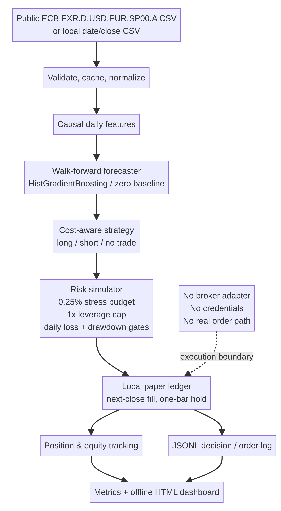

# Automated Forex Paper Trader

A local-only research system that turns a walk-forward EUR/USD return forecast into cost-aware **simulated** orders, checks each order against conservative risk limits, tracks a virtual account, and produces an offline performance dashboard.

> **Paper simulation only. No live-money trading.** This project has no broker adapter, broker URL, account credentials, real order submission, or unattended broker loop. A run never contacts a trading account. Nothing here is financial advice, and historical simulation does not establish a profitable strategy.

## Why this project is cautious

The portfolio's earlier [Forex Prediction Engine (Project 09)](https://github.com/bereket-web/forex-prediction-engine) evaluated 2,827 pooled out-of-sample EUR/USD forecasts per model across five expanding chronological folds. Its zero-change baseline had 34.220 bp MAE, compared with 34.338 bp for gradient boosting and 35.441 bp for a GRU; neither supervised model beat the baseline. This trader therefore treats the predictor as an unproven research signal, includes a no-trade baseline, requires a forecast to clear modeled costs plus an edge buffer, caps gross leverage at 1x, and defaults to a 0.25% per-trade stress-risk budget.

## What it demonstrates

- **Market data:** fetches or reuses public Federal Reserve H.10 / FRED `DEXUSEU` daily observations, and also accepts a local date/close CSV. FRED's series is USD per EUR at a New York noon reference time; it is not an executable bid/ask feed or intraday OHLC data.
- **Prediction:** a compact scikit-learn histogram-gradient-boosting regressor refit on an expanding/rolling past-only window, plus a zero-return baseline. Labels are eligible only after their exit close is observed.
- **Strategy:** long / short / no-trade decisions require predicted return to clear estimated round-trip spread and slippage plus a configurable buffer.
- **Execution:** local-only paper orders are scheduled at a signal close and filled at the next observed close. A trade is closed at the following close, so the forecast target begins after the delayed entry; the simulator never claims it could fill at a price already used to form the signal.
- **Risk:** virtual USD 10,000 starting balance; 0.25% default stress-move budget; position sizing uses a volatility stress move; no more than 1x gross leverage; 2% daily loss block; 5% peak-to-trough drawdown circuit breaker. The close-only source has no intraday stop data, so a stress move is a sizing assumption—not a guaranteed stop order.
- **Position tracking and audit trail:** one position at a time; trades, equity and every decision/order/fill/block/closure are written locally.
- **Dashboard:** self-contained responsive HTML with virtual equity, drawdown, trade statistics, modeled fees and recent paper trades. No web server or hosted service is required.

## Quick start

Python 3.10+ is required. Install the project and test extras:

```bash
python -m venv .venv
source .venv/bin/activate
pip install -e '.[test]'
pytest
ruff check .
```

Or use the checked-in `uv.lock`:

```bash
uv sync --extra test
uv run pytest
uv run ruff check .
```

Fetch the public daily reference series and run a walk-forward paper replay:

```bash
fx-paper ingest
fx-paper simulate --model histgb
```

Or provide your own CSV with `date,close` columns:

```bash
fx-paper simulate --data /path/to/daily_close.csv --model histgb
```

Run the explicit zero-return baseline (normally no trades):

```bash
fx-paper simulate --model zero
```

The default output files are `results/metrics.json`, `results/equity_curve.csv`, `results/trades.csv`, and `results/dashboard.html`. Detailed JSONL decision and paper-order events are written to `logs/`. These local artifacts are ignored by Git. `--refresh` refreshes the FRED cache; `--max-bars 1200` can bound a quick run. Use `fx-paper simulate --help` for configurable modeling, costs and risk limits.

Open `results/dashboard.html` locally in a browser. No account, API key, broker token, or `.env` file is needed.

## Evaluation and interpretation

The engine reports total return, maximum drawdown, daily volatility, a descriptive Sharpe ratio, completed-trade count, win rate, profit factor, average net trade result, modeled fees, refit count, and peak gross leverage. These summarize the chosen historical sample and assumptions; they are not a forecast, statistical proof, or comparable to a broker statement. The `zero` model makes the cost-aware strategy's no-trade outcome explicit. The drawdown breaker is observed at each daily close, so a close-to-close loss or gap can exceed its configured trigger before the next observation; it is not a guaranteed maximum-loss control.

### First full-history replay

Using the refreshed FRED snapshot of 6,979 valid observations from 1999-01-04 through 2026-10-30 with default settings, the walk-forward simulation closed 1,160 paper trades, then latched its 5% drawdown breaker on 2006-10-10. The close-only loss crossed the trigger to a 5.07% peak drawdown before the close-based check could stop further entries; no trades were opened after that date. Virtual equity ended at $10,071.58 from $10,000 (+0.72%), with a 1.012 profit factor, 0.03 descriptive Sharpe ratio, and $393.95 of assumed costs. This is a weak, assumption-sensitive historical result—not evidence of an edge or future profitability. Source rates are reference closes, and no real broker prices or trades were involved.

A historical run uses the full date range and past-only model fits; do not tune thresholds against the same reported period and present the result as independent validation. For stronger research, freeze the strategy first and reserve a later untouched period; compare against no-trade and buy-and-hold with uncertainty estimates; stress test varying spreads, slippage and gaps; and use legally reusable bid/ask market data before drawing any execution conclusions.

## Data provenance

- [FRED DEXUSEU: U.S. dollars to one euro](https://fred.stlouisfed.org/series/DEXUSEU), sourced from the Federal Reserve Board's H.10 release. The public series page warns that graph data are copyrighted; consult its current terms before redistributing observations or row-level derivatives. Downloaded observations are cached under `data/cache/` and excluded from version control.
- The research context and prior forecast findings are documented in the public [Forex Prediction Engine repository](https://github.com/bereket-web/forex-prediction-engine). This project does not redistribute that source series or its row-level forecasts.

## Architecture



The paper ledger is deliberately the terminal execution boundary. No broker client, live endpoint, authentication secret, or path from a forecast to a real account is included.

## Limitations

DEXUSEU is a once-daily reference rate, not executable market data. The simulator assumes a configurable fixed spread and slippage, uses one-observation holds, and omits intraday high/low paths, actual fills, gaps, financing, swaps, liquidity, market impact, broker rejections, outages, taxes, and changes in spread. The assumed transaction costs are not empirically calibrated. Risk limits are simulation controls, not a guarantee against loss. Forecasts may be wrong, unstable, or worthless out of sample; a paper result is not evidence of future profitability.

## License

The software is MIT-licensed. That license does not grant rights to FRED/Federal Reserve observations; review the source terms independently.
